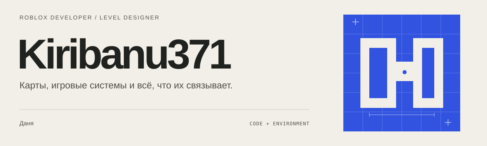

<p align="center">
  
</p>

<p align="center">
  <strong>ROBLOX DEVELOPMENT</strong> &nbsp; / &nbsp; <strong>LEVEL DESIGN</strong> &nbsp; / &nbsp; <strong>WORLD BUILDING</strong>
</p>

<h2 align="center">Из идеи — в место, куда хочется вернуться.</h2>

<p align="center">
Я Даня, <strong>Kiribanu371</strong>. Профессиональный разработчик Roblox-карт.<br/>
Создаю игровые миры с характером: продумываю пространство, собираю атмосферу<br/>
и превращаю креативную задумку в игровой опыт.
</p>

<br/>

<table>
<tr>
<td width="33%" valign="top">
<h3>01 / Пространство</h3>
Маршруты, масштаб, точки интереса. Карта ведёт игрока и оставляет место для открытия.
</td>
<td width="33%" valign="top">
<h3>02 / Характер</h3>
Силуэт, свет, цвет, детали. У каждого мира — собственное настроение и узнаваемый почерк.
</td>
<td width="33%" valign="top">
<h3>03 / Игра</h3>
Окружение работает вместе с механиками. Каждое решение служит тому, что чувствует и делает игрок.
</td>
</tr>
</table>

<br/>

### Мой подход

```text
Идея         →  найти сильный образ
Блокаут      →  почувствовать пространство
Атмосфера    →  дать миру характер
Итерации     →  довести ощущения в игре
```

> **Хорошая карта запоминается ощущением, которое в ней остаётся.**

<p align="center">
  <sub>Roblox Studio · Map Design · World Building · Creative Direction</sub>
</p>
